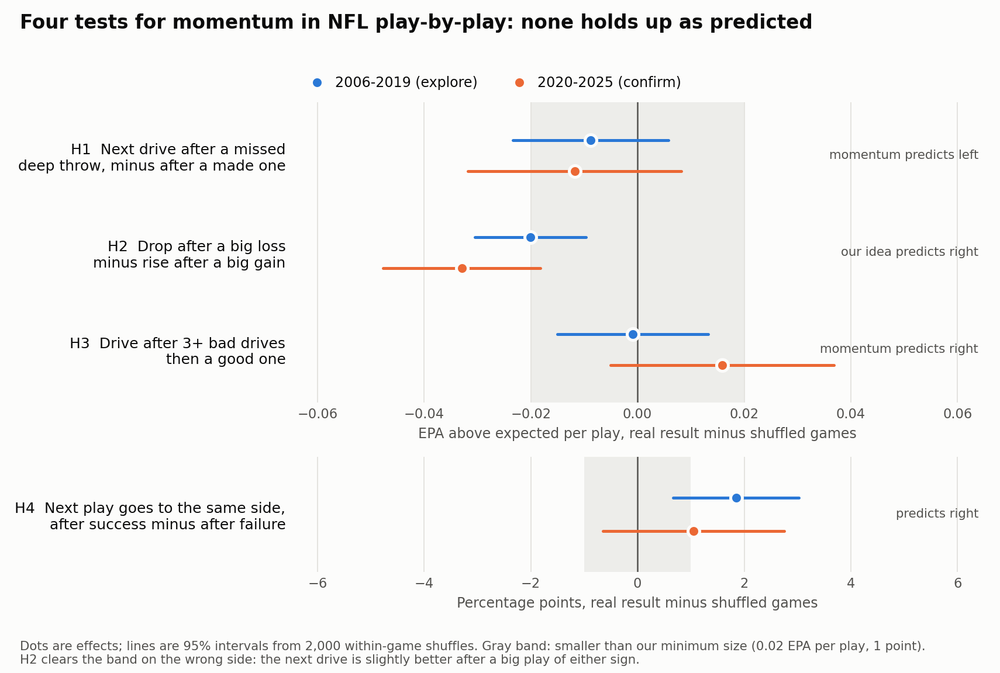

# nfl-momentum

Can we find momentum in NFL play-by-play data? This repo is an entry for The Side Quest's [Momentum Lab](https://thesidequest.com/posts/momentum-lab/) challenge.

Our idea is that momentum is mostly something a team loses. A missed big play, a turnover, or a stalled drive should hurt what the offense does next, and hurt it more than a gain of the same size helps. We test four versions of that idea. A clear "no" is a result we will report.

## Results



No test found momentum in the direction we predicted. Numbers are EPA above expected per play on the next drive, real result minus the shuffle average, for 2006-2019 and then 2020-2025.

- **Missed opportunity: no finding.** The next drive after a missed deep throw is 0.009 and 0.012 worse than after a made one. Both intervals include zero. The 2020-2025 interval is -0.032 to +0.008, so an effect near our 0.02 minimum is still possible.
- **Loss against gain: the opposite of our idea.** A big loss does not hurt the next drive. The next drive is 0.011 and 0.017 better than chance after a loss of 2+ EPA, and 0.009 and 0.016 better after a gain of 2+ EPA. This holds in close games and with each team's last drive removed.
- **Breakthrough after struggle: no finding.** -0.001 in 2006-2019 and +0.016 in 2020-2025, with both intervals including zero.
- **Where the ball goes: did not confirm.** After a success the next play went to the same side 1.9 points more often in 2006-2019 (p = 0.003). In 2020-2025 it was 1.0 points with an interval of -0.7 to +2.8.

Three secondary patterns appeared in both sets of seasons. They are decisions, and they cannot count as findings under our rule.

- After a missed deep throw, the share of next-drive passes that are deep is 0.7 and 0.9 points lower than after a made one. The base rate is 11.8%.
- After a successful pass, the next pass is 0.3 and 0.5 yards deeper than after a failed one.
- After a successful run, teams call a run again 6.8 and 7.4 points more often than after a failed run. Our distance groups are coarse, so part of this is the shorter distance to go.

Full tables: [results/explore.csv](results/explore.csv) and [results/confirm.csv](results/confirm.csv).

## How the tests work

[HYPOTHESES.md](HYPOTHESES.md) has the exact definitions. It was committed before any test touched the 2020-2025 seasons.

- Every outcome is EPA above expected: a play's EPA minus what the down, distance, field position, clock, score, and betting line predict.
- Every test compares events inside one team's game, then repeats the comparison on 2,000 shuffles of that game. The shuffle keeps how good the team was that day and removes only the order.
- We explore on 2006-2019 and confirm once on 2020-2025.

## Run it

```
pip install pandas pyarrow scikit-learn scipy
python src/download.py        # nflverse play-by-play and FTN charting, about 480 MB
python src/prep.py            # one regular-season plays file
python src/features.py        # play and drive tables with EPA above expected
python src/check_shuffle.py   # the shuffle finds nothing in fake games without momentum, and finds a planted effect
python src/replicate.py       # two numbers from the Momentum Lab post, as a check on the data
python src/run_tests.py explore
python src/run_tests.py confirm
python src/chart.py
```

Results are written to `results/`.

## Data

- [nflverse play-by-play](https://github.com/nflverse/nflverse-data/releases/tag/pbp), regular season 2002-2025. The tests use 2006-2025. The earlier seasons are only for the replication check.
- [FTN charting](https://github.com/nflverse/nflverse-data/releases/tag/ftn_charting) through nflverse, 2022-2025.
