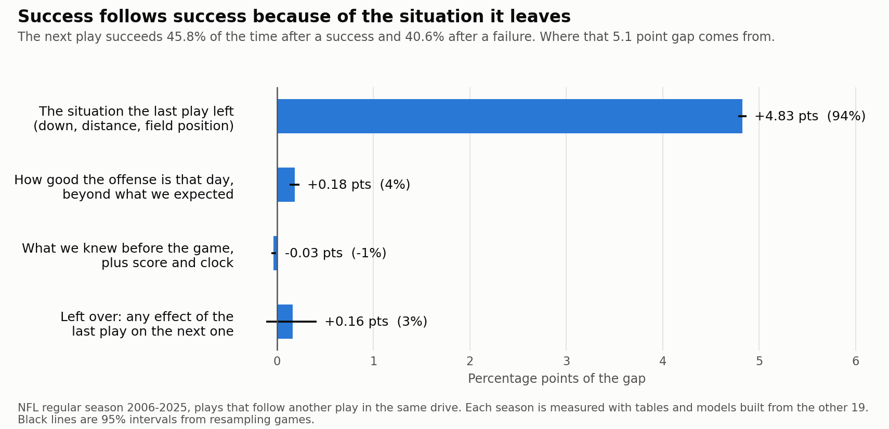
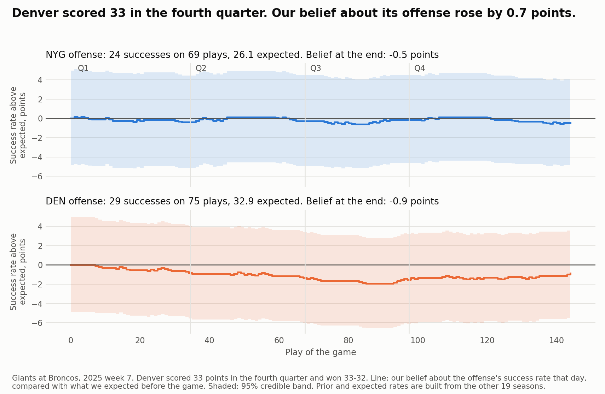

# nfl-momentum

Can we find momentum in NFL play-by-play data? This repo is an entry for The Side Quest's [Momentum Lab](https://thesidequest.com/posts/momentum-lab/) challenge.

We started with the idea that momentum is mostly something a team loses: a missed big play, a turnover, or a stalled drive should hurt what the offense does next. We tested four versions of that idea, found nothing of the size we set in advance, and then built a model of what the feeling of momentum is made of.

## What we found

A play does not change how well the offense plays afterward. What feels like momentum is almost all the situation that the last play leaves behind.



- The next play succeeds 45.8% of the time after a success and 40.6% after a failure.
- A table that knows only the down, the distance, and the field zone predicts 94% of that 5.1 point gap. It predicts all of the 22.7 point gap in pass rate, and all of the 3.2 point gap in sacks and turnovers.
- A failure often leaves third and long. There 93% of calls are passes and 12% of plays end in a sack or turnover. One mistake leads to another through the situation.

The game also tells us a little about how good the offense is that day. We track that as a Beta-Binomial belief. The prior counts as about 380 plays, so one game moves it slowly.



- **The belief forecasts the next drive, at the correct size.** The slope of real results on the belief is 1.13 (95% interval 0.96 to 1.31), and it is positive in all three eras. Offenses in the top fifth of belief beat the bottom fifth by 2.1 points of success rate on the next drive, about 0.2 points on the scoreboard.
- **Steady success carries the information.** One standard deviation more successes so far is worth 0.013 EPA per play on the next drive. Big gains add 0.005. Big losses add nothing (0.000, interval -0.003 to 0.003), so we did not find that mistakes tell us more than big plays do.
- **Recent plays count a little extra.** A previous drive one standard deviation better adds 0.2 points of success rate to the next drive, on top of the belief. The sign is the same in all three eras.

[MODEL.md](MODEL.md) has the definitions. Every season is measured with tables, models, and priors built from the other 19 seasons. Full table: [results/model.csv](results/model.csv).

## The four tests


Before the model, we tested four versions of "an event changes what the offense does next". None held in the direction we predicted. Numbers are EPA above expected per play on the next drive, real result minus the shuffle average, for 2006-2019 and then 2020-2025.

- **Missed opportunity: no finding.** The next drive after a missed deep throw is 0.009 and 0.012 worse than after a made one. Both intervals include zero. With a prior centered on no effect, the chance that the effect is smaller than 0.02 is 96%.
- **Loss against gain: the opposite of our idea.** A big loss does not hurt the next drive. The next drive is 0.011 and 0.017 better than chance after a loss of 2+ EPA, and 0.009 and 0.016 better after a gain of 2+ EPA. This holds in close games and with each team's last drive removed.
- **Breakthrough after struggle: no finding.** -0.001 in 2006-2019 and +0.016 in 2020-2025, with both intervals including zero.
- **Where the ball goes: did not confirm.** After a success the next play went to the same side 1.9 points more often in 2006-2019 (p = 0.003). In 2020-2025 it was 1.0 points with an interval of -0.7 to +2.8.

Three secondary patterns appeared in both sets of seasons. They are decisions, and they cannot count as findings under our rule.

- After a missed deep throw, the share of next-drive passes that are deep is 0.7 and 0.9 points lower than after a made one. The base rate is 11.8%.
- After a successful pass, the next pass is 0.3 and 0.5 yards deeper than after a failed one.
- After a successful run, teams call a run again 6.8 and 7.4 points more often than after a failed run. Our distance groups are coarse, so part of this is the shorter distance to go.

Full tables: [results/explore.csv](results/explore.csv), [results/confirm.csv](results/confirm.csv), [results/intervals.csv](results/intervals.csv), and [results/posterior.csv](results/posterior.csv).

## How the tests work

[HYPOTHESES.md](HYPOTHESES.md) has the exact definitions. It was committed before any test touched the 2020-2025 seasons.

- Every outcome is EPA above expected: a play's EPA minus what the down, distance, field position, clock, score, and betting line predict.
- Every test compares events inside one team's game, then repeats the comparison on 2,000 shuffles of that game. The shuffle keeps how good the team was that day and removes only the order.
- We explore on 2006-2019 and confirm once on 2020-2025.

## Run it

```
pip install pandas pyarrow scikit-learn scipy
python src/download.py        # nflverse play-by-play and FTN charting, about 480 MB
python src/prep.py            # one regular-season plays file
python src/features.py        # play and drive tables with EPA above expected
python src/check_shuffle.py   # the shuffle finds nothing in fake games without momentum, and finds a planted effect
python src/replicate.py       # two numbers from the Momentum Lab post, as a check on the data
python src/run_tests.py explore
python src/run_tests.py confirm
python src/chart.py
python src/intervals.py      # intervals from resampling games, and the Bayesian reading
python src/model_fit.py      # each season from the other 19, about 20 minutes
python src/model.py          # the three parts of MODEL.md
python src/model_charts.py
```

Results are written to `results/`.

## Data

- [nflverse play-by-play](https://github.com/nflverse/nflverse-data/releases/tag/pbp), regular season 2002-2025. The tests use 2006-2025. The earlier seasons are only for the replication check.
- [FTN charting](https://github.com/nflverse/nflverse-data/releases/tag/ftn_charting) through nflverse, 2022-2025.
